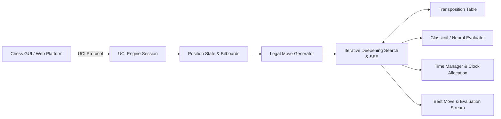

# RookSac

> Every sacrifice has a purpose.

RookSac is a modern C++20 autonomous chess engine and computational chess platform. It implements a complete, self-contained tournament engine pipeline: bitboard position representation, perft-certified legal move generation, classical tapered evaluation with PeSTO/CPW piece-square tables, Static Exchange Evaluation (SEE), fail-soft Negamax with Alpha-Beta and modern pruning heuristics, memory-bounded Transposition Tables, UCI protocol compliance, all FIDE standard time controls, and an optional native forward-pass neural evaluation engine.

---

## Verified Features

- **Bitboard Engine**: Strongly typed squares, bitboards, and compact 16-bit move encoding with transactional make/unmake and Zobrist hash invariants.
- **Move Generation**: Perft-certified legal move generation covering castling, en passant, promotions, and check evasions (Positions 1–6 and Kiwipete verified).
- **Search Architecture**: Fail-soft Negamax with Alpha-Beta pruning, Principal Variation Search (PVS), Static Exchange Evaluation (SEE), Delta Pruning, Late Move Reductions (LMR), Null-Move Pruning (NMP), Aspiration Windows, Killer heuristic (2 slots/ply), History heuristic table, and Quiescence search.
- **Search Efficiency**: 75.6% search node reduction compared to the unpruned baseline (87.8% reduction on the Kiwipete tactical position).
- **Transposition Table**: 64-bit incremental Zobrist hashing with memory-bounded, generation-aged replacement scheme (configurable size, default 64 MB).
- **All Standard Time Controls**: Specialized time allocation supporting Blitz (`3+2`, `5+0`), Rapid (`10+0`, `10+5`, `15+10`), Classical (`30+0`), fixed move time, search depth limits, and 50 ms emergency low-clock reserve protection.
- **Match Harness & SPRT**: Built-in multi-game paired-opening match harness (`rooksac_match_harness`) with PGN serialization and Sequential Probability Ratio Test evaluation (`tools/sprt_match.py`).
- **Real Neural Inference**: Pure C++ forward-pass convolutional residual network runner (`.rks` binary container) with strict format verification, feature parity, legal-move policy ordering, and graceful classical fallback.
- **Web Platform**: Scalable FastAPI backend with persistent worker pooling and a clean, responsive React 19 frontend chessboard featuring live clocks, sound synthesis, move history, and game-over modals.

---

## Architecture



---

## Build and Testing

### Prerequisites

- **C++ Compiler**: GCC 14+, Clang 16+, or MSVC 2022 (C++20 required)
- **Build Tools**: CMake 3.23+ and Ninja
- **Python**: 3.12+ (managed via [uv](https://docs.astral.sh/uv/))
- **Node.js**: 22+ (for frontend)

### Python Setup (uv)

[uv](https://docs.astral.sh/uv/) is the Python package manager for this project. It replaces pip entirely.

```bash
# Install uv (one-time, any platform)
pip install uv
# or: curl -LsSf https://astral.sh/uv/install.sh | sh

# Install all Python dependencies (backend + tools) from the lockfile
uv sync --frozen

# Run backend in dev mode
uv run uvicorn app.backend.main:app --reload

# Run backend tests
uv run python -m unittest discover -s app/backend/tests
```

### Building the Native Engine

```bash
# Configure Release build
cmake -B build -G Ninja -DCMAKE_BUILD_TYPE=Release

# Compile engine and test executables
cmake --build build --parallel

# Run comprehensive engine test suite (14/14 tests)
ctest --test-dir build --output-on-failure
```

### Running the UCI Engine Directly

```bash
# Launch interactive UCI session
./build/rooksac

# Example UCI commands:
uci
isready
position startpos
go wtime 180000 btime 180000 winc 2000 binc 2000
```

### Running Matches & Benchmarks

```bash
# Run 8-position benchmark suite:
./build/rooksac_bench --depth 4 --json docs/benchmarks/release_bench_depth4.json

# Run 20-game paired match with fixed opening suite:
./build/rooksac_match_harness --white negamax --black greedy --depth 2 --games 20 --openings tools/openings.epd --pgn match.pgn

# Calculate SPRT stopping conditions and 95% Elo CI:
python tools/sprt_match.py --pgn match.pgn --elo0 0 --elo1 5
```

---

## Repository Structure

```text
rooksac/
├── docs/                      # Authoritative technical documentation and ADRs
│   ├── ARCHITECTURE.md        # Engine architecture specification
│   ├── BASELINE.md            # Performance and accuracy baselines
│   ├── COMPLIANCE.md          # UCI protocol compliance matrix
│   ├── ENGINE_STRENGTH.md     # Empirical strength and match reports
│   ├── PROVENANCE.md          # Complete provenance and licensing ledger
│   └── decisions/             # Architecture Decision Records (ADRs)
├── engine/                    # Native C++20 engine implementation
│   ├── apps/                  # UCI engine and benchmark executables
│   ├── include/rooksac/       # Public engine headers
│   ├── src/                   # C++ engine sources
│   └── tests/                 # Unit, integration, and regression tests
├── research/                  # ML training and evaluation pipeline
│   ├── checkpoints/           # Model metadata and test artifacts
│   ├── data/                  # Dataset manifests and quality reports
│   ├── nn/                    # PyTorch models, features, and training scripts
│   └── tests/                 # Pipeline verification tests
├── tools/                     # Python utilities (SPRT, model export, PGN extract)
└── app/                       # Full-stack web application
    ├── backend/               # FastAPI UCI engine manager
    └── frontend/              # React 19 responsive chess interface
```

---

## License

RookSac is open source software released under the [MIT License](LICENSE).
Third-party constants (PeSTO PSTs) and standard test suites are documented in [PROVENANCE.md](docs/PROVENANCE.md).
