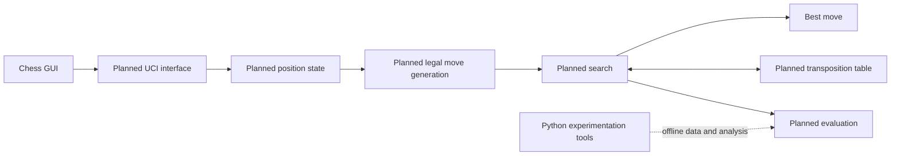

# RookSac

> Every sacrifice has a purpose.

RookSac is a planned C++20 chess engine and a long-term computer-chess engineering project. It exists to build, understand, and measure the complete engine pipeline: position representation, legal move generation, evaluation, search, hashing, time control, testing, and performance work.

## Status

**Phase 0 — repository foundation and documentation.** RookSac does not yet contain an engine, a build system, tests, UCI support, benchmarks, or a playable binary. The documents in this repository describe intended design and planned milestones; they are not evidence of implemented functionality.

## Vision

The project aims for a modern, maintainable engine whose improvements are correct, measurable, and explainable. Correctness comes before optimization; measurements guide performance decisions; and documentation records why a design exists.

## Planned capabilities

- Bitboard-based position representation and FEN support.
- Correct legal move generation, validated with perft.
- Incremental classical evaluation and a progressively stronger search.
- Hashing, transposition tables, time management, and UCI interoperability.
- Python tooling for experiments and analysis, separate from the C++ runtime.

## Technology stack

| Area | Direction |
| --- | --- |
| Engine | C++20 |
| Build system | CMake |
| Platforms | Windows and Linux initially |
| Protocol target | UCI |
| Experiment tooling | Python 3 |

## Intended architecture



See [Architecture](docs/architecture/ARCHITECTURE.md) for the intended component boundaries.

## Intended repository layout

```text
rooksac/
├── .github/workflows/       # Future automation, introduced when useful
├── docs/                    # Product, architecture, engine, testing, and standards
├── include/rooksac/         # Future public C++ headers
├── src/                     # Future C++ implementation
├── tests/                   # Future automated tests
├── benchmarks/              # Future reproducible benchmarks
├── tools/python/            # Future Python experimentation tools
├── README.md
├── AGENTS.md
├── CONTRIBUTING.md
└── SECURITY.md
```

Source, test, and tooling directories are intentionally not created yet: empty directories are not tracked by Git, and Phase 0 introduces no implementation.

## Roadmap

The work proceeds from position correctness to engine strength: foundation; position management; legal moves; basic search; alpha-beta; iterative deepening and hashing; evaluation; UCI; performance; advanced search; Python research; and a validated v1.0. Details and acceptance criteria are in the [roadmap](docs/product/ROADMAP.md).

## Documentation

The [documentation index](docs/README.md) is the entry point for product direction, architecture, engine design, testing, and governance. New contributors should begin with the [vision](docs/product/VISION.md), [requirements](docs/product/REQUIREMENTS.md), and [agent guidance](AGENTS.md).

## Build and usage

Build and usage instructions are not available because no buildable engine exists yet. The intended approach is documented in [Build guidance](docs/engineering/BUILD.md); commands will be added only alongside a real CMake configuration.

## Contributing

Contributions should stay within an agreed phase, include proportionate validation, and update documentation when behavior or design changes. Read [CONTRIBUTING.md](CONTRIBUTING.md) before proposing work.

## License

No license has been selected. Reuse, distribution, and contribution terms remain open until a license decision is documented.
