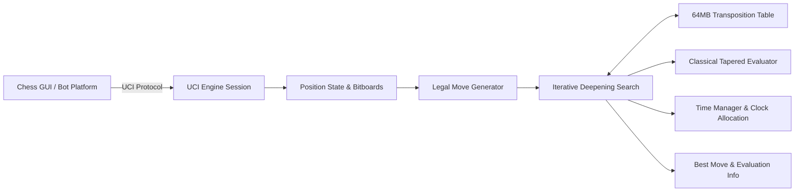

# RookSac

> Every sacrifice has a purpose.

RookSac is a modern C++20 chess engine and computational chess engineering project. It implements a complete, self-contained tournament engine pipeline: bitboard position representation, legal move generation, tapered evaluation, search with modern pruning heuristics, Zobrist transposition table, 3+2 blitz time control, and standard UCI protocol compliance.

## Status

**Version 0.1.0 — Core Engine & UCI Implementation Complete.**

RookSac features:
- **Bitboard Engine**: Strongly typed squares, bitboards, and compact 16-bit move encoding with transactional make/unmake.
- **Move Generation**: Perft-certified legal move generation covering castling, en passant, promotions, and check evasions.
- **Search Architecture**: Fail-soft Negamax with Alpha-Beta pruning, Principal Variation Search (PVS), Late Move Reductions (LMR), Null-Move Pruning (NMP), Aspiration Windows, Killer heuristic (2 slots/ply), History heuristic table, and Quiescence search.
- **Zobrist Transposition Table**: 64-bit incremental hashing with memory-bounded, generation-aged transposition table (default 64 MB).
- **Time Management**: Specialized 3+2 blitz time allocation featuring 100 ms hard reserve protection, emergency low-clock handling, and cooperative stop checks.
- **UCI Compliance**: Full support for Universal Chess Interface (`uci`, `isready`, `position`, `go`, `stop`, `setoption Hash`, etc.) with per-depth streaming search metrics.
- **Web Platform**: Scalable FastAPI backend with persistent worker process pooling and a React 19 frontend chessboard.

See [project status](docs/PROJECT_STATUS.md) for detailed implementation records.

---

## Architecture



---

## Build and Testing

### Prerequisites
- **C++ Compiler**: GCC 12+, Clang 15+, or MSVC 2022 (C++20 required)
- **Build Tools**: CMake 3.23+ and Ninja
- **Python**: 3.12+ (for backend and research tools)
- **Node.js**: 22+ (for frontend)

### Building the Native Engine

```bash
# Configure Release build with Ninja
cmake -B build -G Ninja -DCMAKE_BUILD_TYPE=Release

# Compile engine and test executables
cmake --build build --parallel

# Run comprehensive engine test suite (13/13 tests)
ctest --test-dir build --output-on-failure
```

### Running the UCI Engine Directly

```bash
# Launch interactive UCI session
./build/rooksac

# Example UCI commands:
uci
isready
position startpos
go wtime 180000 btime 180000 winc 2000 binc 2000
```

---

## Repository Structure

```text
rooksac/
├── docs/                      # Authoritative technical documentation
├── engine/                    # Native C++20 chess engine
│   ├── include/rooksac/       # Public engine headers
│   ├── src/                   # Engine implementation
│   ├── apps/                  # rooksac standalone executable
│   └── tests/                 # CTest test suite
├── app/                       # Application platform
│   ├── backend/               # FastAPI backend with engine worker pool
│   └── frontend/              # React 19 web interface
├── research/                  # Supervised neural evaluation research (PyTorch)
├── tools/                     # PGN parsing and SPRT match tools
├── CMakeLists.txt             # Root CMake configuration
├── LICENSE                    # MIT License
└── README.md
```

---

## License

This project is licensed under the [MIT License](LICENSE).
