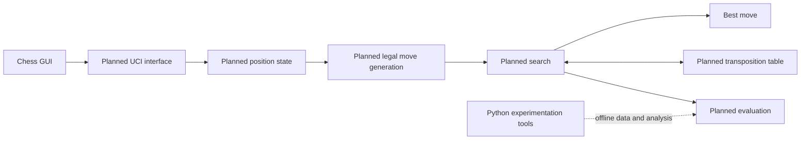

# RookSac

> Every sacrifice has a purpose.

RookSac is a planned C++20 chess engine and a long-term computer-chess engineering project. It exists to build, understand, and measure the complete engine pipeline: position representation, legal move generation, evaluation, search, hashing, time control, testing, and performance work.

## Status

**Alpha-Beta pruning, staged move ordering, Negamax search, baseline agents (random and greedy), material evaluation, match harness, legal move generation, perft certification, position state, FEN parsing, and core chess primitives complete; quiescence search and positional evaluation planned.** RookSac has C++20 value types, bitboard helpers, a compact move encoding, a full position state representation with piece bitboards and square mailbox, transactional FEN parsing and serialization, exact make/unmake move execution with `UndoState`, compile-time leaper attacks, ray-stepping slider attacks, square attack detection, bounded stack `MoveList`, pseudo-legal and legal move generation, check/checkmate/stalemate/fifty-move draw detection, verified Perft suite across multiple depths, material evaluation, baseline `Agent` policies (`RandomAgent`, `GreedyAgent`), fail-soft `NegamaxAgent` with Alpha-Beta pruning and MVV-LVA move ordering, standalone match execution harness (`rooksac_match_harness`), CTest coverage, and CI quality gates. See [project status](docs/PROJECT_STATUS.md) for the authoritative status summary.

## Vision

The project aims for a modern, maintainable engine whose improvements are correct, measurable, and explainable. Correctness comes before optimization; measurements guide performance decisions; and documentation records why a design exists.

## Planned capabilities

- Bitboard-based position representation and FEN support.
- Correct legal move generation, validated with perft.
- Incremental classical evaluation and a progressively stronger search.
- Hashing, transposition tables, time management, and UCI interoperability.
- Python tooling for experiments and analysis, separate from the C++ runtime.

## Technology stack

| Area | Direction |
| --- | --- |
| Engine | C++20 |
| Build system | CMake |
| Platforms | Windows and Linux initially |
| Protocol target | UCI |
| Experiment tooling | Python 3 |

## Intended architecture



See [architecture](docs/architecture/architecture.md) for the intended component boundaries.

## Intended repository layout

```text
rooksac/
├── docs/                    # Authoritative project documentation
├── engine/                  # Native engine boundary
│   ├── include/rooksac/     # Core public C++ value types and bitboard helpers
│   ├── src/                 # Future non-header-only implementation
│   └── tests/               # Core primitive and build smoke tests
├── research/                # Future offline Python experiments
├── app/                     # Future process-boundary web product
│   ├── backend/
│   └── frontend/
├── benchmarks/              # Future reproducible benchmarks
├── tools/                   # Future repository tooling
├── deploy/                  # Future deployment assets
├── README.md
├── AGENTS.md
├── CONTRIBUTING.md
└── SECURITY.md
```

The engine currently provides only core value types and bitboard primitives. It has no position state, rules, move generation, search, or application behavior. The proposed boundaries are defined in [ADR-007](docs/decisions/adr-007-repository-layout.md).

## Roadmap

The work proceeds from position correctness to engine strength: foundation; position management; legal moves; basic search; alpha-beta; iterative deepening and hashing; evaluation; UCI; performance; advanced search; Python research; and a validated v1.0. Details and acceptance criteria are in the [roadmap](docs/product/roadmap.md).

## Documentation

The [documentation index](docs/README.md) is the entry point for product direction, architecture, engine design, testing, operations, and governance. New contributors should begin with the [vision](docs/product/vision.md), [requirements](docs/product/requirements.md), [contribution guide](CONTRIBUTING.md), and [agent guidance](AGENTS.md).

## Build and usage

The repository builds core primitive tests, not a playable chess engine. See [build guidance](docs/engineering/build.md) for the supported toolchains, presets, quality targets, and exact commands.

## Contributing

Contributions should stay within an agreed phase, include proportionate validation, and update documentation when behavior or design changes. Read [CONTRIBUTING.md](CONTRIBUTING.md) before proposing work.

## License

No license has been selected. Reuse, distribution, and contribution terms remain open until the owner confirms a licensing decision. The current inventory and owner decision checklist are in [licensing and notices](docs/legal/LICENSING_AND_NOTICES.md).
