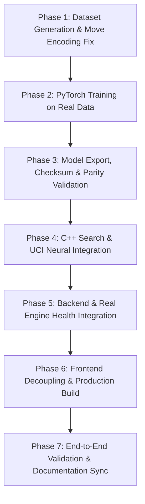

# RookSac — Full Implementation Plan & Roadmap

**Target**: Production C++ Chess Engine with PyTorch-Trained Policy-Value Neural Network, Native C++ Inference, Search Integration, FastAPI Backend, and React Frontend.

---

## Phase Overview and Dependencies

---

## Phase 1: Action Encoding & Position Dataset Pipeline
### Goal
Resolve promotion action collision and implement a streaming per-position dataset generator from PGN games.

### Work Breakdown
1. **Move Encoding Extension**:
   - Update `research/nn/features.py` and `engine/include/rooksac/neural_evaluator.hpp`:
     - Disambiguate underpromotions (`n`, `b`, `r`). For example, standard from/to moves (4096) plus 3 promotion piece types $\times$ 8 files $\times$ 3 directions = 72 underpromotion slots (or 4672 AlphaZero action encoding).
     - Ensure White and Black promotion moves have deterministic bijective mapping.
2. **Per-Position Dataset Generation (`tools/pgn_extract.py`)**:
   - Add position tracking to replay PGN moves using internal position logic or Python chess rules.
   - For every move played in a game, emit:
     - Board state representation / FEN.
     - Target move with distinct promotion label.
     - Final game result from the side-to-move perspective ($+1.0$, $0.0$, $-1.0$).
   - Output position samples to compressed sharded files (`.npz` or JSONL) with strict whole-game partitioning to preserve zero test leakage.

### Acceptance Criteria
- Unit tests verify distinct action labels for `e7e8q`, `e7e8r`, `e7e8b`, and `e7e8n`.
- Running `tools/pgn_extract.py` generates valid train/val/test position sample files with zero leakage.

---

## Phase 2: PyTorch Model Training with Real Data
### Goal
Train a genuine convolutional residual policy-value neural network on real chess positions.

### Work Breakdown
1. **Dataset Loader**:
   - Update `research/nn/dataset.py` to stream and load real extracted position shards instead of hardcoded lists.
2. **Training CLI (`research/nn/train.py`)**:
   - Replace synthetic samples in `main()` with CLI options for `--train-data`, `--val-data`, `--test-data`, `--epochs`, `--batch-size`, and `--lr`.
   - Add metric logging: policy top-1, top-3 accuracy, and value MSE.
3. **Training Execution**:
   - Train a genuine baseline model (e.g. 4 blocks, 64 channels) on extracted positions until convergence.
   - Save checkpoint `research/checkpoints/policy_value_net.pt` and metadata.

### Acceptance Criteria
- Policy top-1 accuracy $> 30\%$ and value MSE $< 0.5$ on held-out validation positions.
- Training pipeline runs end-to-end via CLI and produces reproducible checkpoint artifacts.

---

## Phase 3: Native Model Export, Checksum & Parity Verification
### Goal
Export trained PyTorch weights to native `.rks` binary container with BatchNorm fusion, format checksums, and strict numeric parity.

### Work Breakdown
1. **`.rks` Format Specification & Checksum**:
   - Formalize `.rks` v2 header with:
     - Magic header (`ROOKSAC2` or `ROOKSAC1` with checksum field).
     - Architecture metadata: `version`, `num_blocks`, `channels`, `num_actions`.
     - 32-bit CRC32 or 256-bit SHA-256 checksum over the weights payload.
   - Update `tools/export_model.py` to calculate and append the checksum.
   - Update `engine/src/neural_evaluator.cpp` to verify the checksum on file load.
2. **BatchNorm Fusion Parity**:
   - Verify Conv + BatchNorm fusion mathematically for all residual blocks and heads in eval mode.
3. **Cross-Language Numeric Parity Test**:
   - Create a test script (`tools/verify_parity.py` or unit test) that passes standard test positions through both PyTorch and C++ `NeuralEvaluator`.
   - Confirm policy logits difference $\max |p_{\text{pytorch}} - p_{\text{cpp}}| < 10^{-4}$ and value difference $< 10^{-4}$.

### Acceptance Criteria
- `.rks` export succeeds with validated payload checksum.
- C++ `testRealModelInference` passes without being skipped.
- Numeric parity between PyTorch and C++ is strictly within floating-point tolerance.

---

## Phase 4: C++ Search & UCI Neural Integration
### Goal
Connect `NeuralEvaluator` into active engine search and expose evaluation mode via UCI.

### Work Breakdown
1. **Search Integration**:
   - Wire `NeuralEvaluator` into `rooksac::search::search`:
     - Allow passing an active evaluator instance or `EvalMode` in `SearchOptions` (`Classical`, `NeuralValue`, `Blended`).
     - In leaf evaluation, evaluate via neural network when enabled.
     - In move ordering (`move_order.cpp`), optionally bias root or interior move order using policy logits (`orderMovesByPolicy`).
2. **UCI Options**:
   - Register UCI options:
     - `option name EvalMode type combo default Classical options Classical Neural Blended`
     - `option name ModelPath type string default <path>`
   - Update `handleSetOption` in `uci.cpp` to load the model and set the active mode.
   - Report model status in `uci` diagnostics.
3. **Fallback Discipline**:
   - If model file is missing or corrupted, log a warning and fall back to classical tapered evaluation without crashing.

### Acceptance Criteria
- Running `rooksac` with `setoption name EvalMode value Neural` and `setoption name ModelPath value ...` uses neural evaluation in `go depth`.
- All C++ unit and regression tests pass (14/14).

---

## Phase 5: FastAPI Backend & Engine Orchestration
### Goal
Ensure backend properly configures engine workers and tests genuine engine readiness.

### Work Breakdown
1. **Engine Process Configuration**:
   - Update `app/backend/engine_manager.py` to send `EvalMode` and `ModelPath` from environment or configuration during `start()`.
2. **Real Health Check**:
   - Update `app/backend/routes.py` `GET /api/v1/health`:
     - Actively ping the engine pool or check worker process health (`isready` $\to$ `readyok`).
     - Return `engine_ready: false` and HTTP 503 if the binary is missing or unresponsive.
3. **Automated Backend Tests**:
   - Add tests covering engine health reporting on missing binary and successful startup.

### Acceptance Criteria
- `GET /api/v1/health` accurately reflects actual engine process readiness.
- Backend analysis requests execute with configured engine mode.
- All backend tests pass.

---

## Phase 6: Frontend Decoupling & Production Build
### Goal
Support standalone frontend deployment with configurable backend URL and production packaging.

### Work Breakdown
1. **Configurable API Base URL**:
   - Update `app/frontend/src/api/client.ts` and `websocket.ts` to use `import.meta.env.VITE_API_URL || "/api/v1"`.
   - Update WebSocket client to infer protocol (`ws:` / `wss:`) and host from API configuration.
2. **CORS & Environment Setup**:
   - Ensure backend `ALLOWED_ORIGINS` in `config.py` correctly parses origins from environment variables.
3. **Frontend Tests & Build**:
   - Update Vitest specs to verify API client behavior with custom baseURL.
   - Run production Vite build and test bundle assets.

### Acceptance Criteria
- Frontend correctly connects to backend when hosted on a different origin.
- All frontend Vitest tests pass (12/12).
- Production build succeeds without warnings.

---

## Phase 7: End-to-End Validation & Documentation Sync
### Goal
Validate full tournament readiness and synchronize all documentation with actual repository behavior.

### Work Breakdown
1. **End-to-End Match Validation**:
   - Run SPRT / match harness comparing classical evaluation vs neural evaluation.
2. **Documentation Accuracy**:
   - Update `docs/PROJECT_STATUS.md`, `docs/BASELINE.md`, `README.md`, and `docs/ml/README.md`.
   - Ensure no document claims a feature is complete until backed by an automated passing test.

### Acceptance Criteria
- Clean CI run across C++ engine build/tests, Python backend tests, and frontend build/tests.
- Zero discrepancies between documentation and code.

