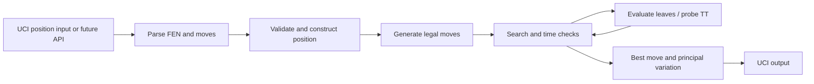

# Data flow

1. **Input and parsing:** Future boundary code accepts supported protocol input. Malformed syntax, unsupported options, or impossible state must be handled explicitly rather than silently becoming search state.
2. **Position:** The planned position model stores pieces, side to move, castling rights, en-passant information, and move counters. Inconsistent state is a correctness failure.
3. **Legal moves:** Pseudo-legal candidates must be filtered or generated with rules that ensure the own king is not left in check. Missing special moves or incorrect attack detection corrupts every later result.
4. **Search:** The controller observes stop conditions and recursively explores ordered legal moves. It must restore state exactly after every branch.
5. **Evaluation and caching:** Evaluation supplies a score at leaves; hashing and a table may reuse valid bounded results. Collision and bound misuse are important risks.
6. **Output:** The selected move is formatted only after it has been validated in the current position. UCI output must remain protocol-compliant once supported.

No part of this flow is implemented in Phase 0.
