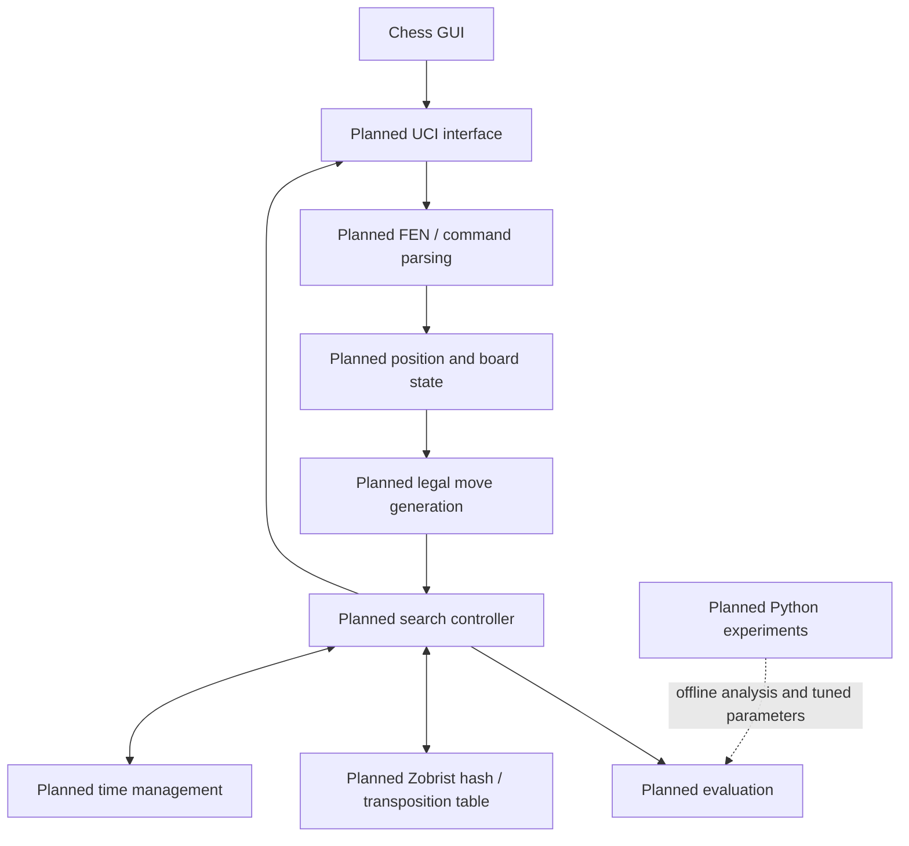

# Architecture

All components below are **planned**. Phase 0 contains no executable engine.

The engine is intended as a modular monolith: subsystems have explicit C++ interfaces but are delivered and linked as one native application. UCI and FEN handling are boundary code; position, move generation, search, evaluation, hashing, and timing form the engine core. Python processes data offline and never sits in the real-time move-selection path.

Key constraints are correctness at state transitions, low allocation and predictable memory on hot paths, and independent testability. See [engine design](engine-design.md), [data flow](data-flow.md), [decisions](../decisions/README.md), and the [repository-layout ADR](../decisions/adr-007-repository-layout.md).
